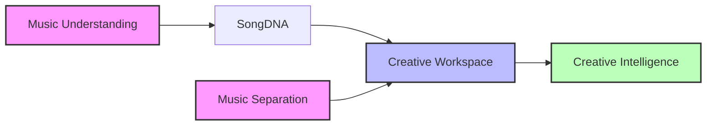
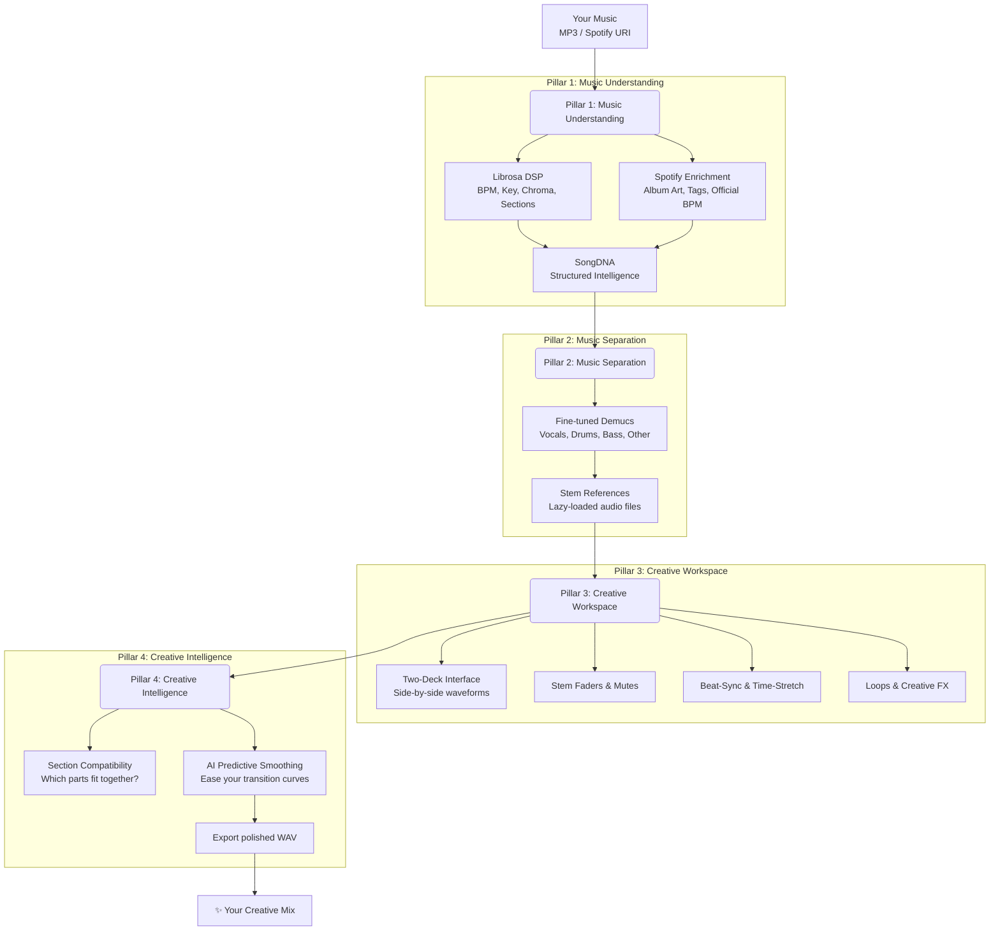

# EchoInsight

**X-ray vision for music. A creative workspace for the curious conductor.**


EchoInsight is an AI-powered desktop platform that lets you see inside a song, separate its layers, and creatively mix two tracks side-by-side. It bridges the gap between raw audio analysis and hands-on musical experimentation.

Built on four robust pillars:



---

## The Journey: Hear → See → Understand → Experiment → Create



---

## The Four Pillars in Detail

| Pillar | What it does | Why it matters | Status |
| :--- | :--- | :--- | :--- |
| **1. Music Understanding** | Extracts rhythm, harmony, structure, and timbre using **Librosa**. Enriches with optional **Spotify metadata** (album art, official BPM, genre). | Turns a raw audio file into a structured, explainable **SongDNA**—the engine that powers everything else. | ✅ Implemented (v0.1–v0.2) |
| **2. Music Separation** | Isolates Vocals, Drums, Bass, and Other instruments using a **fine-tuned Demucs** model. Includes dataset curation and academic training pipelines. | Gives you the building blocks for creative mixing. You don't just hear the song—you see its ingredients. | 🔬 Research (Dataset fine-tuning) |
| **3. Creative Workspace** | A local, real-time two-deck mixer. Side-by-side waveforms, stem-level faders, beat-synced playback, loop selection, and effects (reverb/echo). | This is the "choir instructor" experience. You conduct the arrangement visually and audibly. | 🚧 In Development (Prototyping UI) |
| **4. Creative Intelligence** | Suggests compatible sections between songs (BPM, Key, Chroma, Energy). Offers AI-assisted transition smoothing based on your fader moves. | Takes the guesswork out of mixing. The AI assists without taking over—you remain in control. | 📝 Conceptual Design (Algorithm definition) |

---

## Architecture at a Glance

EchoInsight follows a **strict four-tier layered architecture** to keep concerns separate and maintainable:

```text
┌─────────────────────────────────────────────────┐
│  APPLICATION LAYER  (src.app/)                  │
│  Creative Workspace UI, CLI entry points        │
├─────────────────────────────────────────────────┤
│  INFRASTRUCTURE LAYER  (src.analysis/)          │
│  DSP extraction, separation, comparison         │
├─────────────────────────────────────────────────┤
│  CONFIGURATION LAYER  (src.config/)             │
│  Immutable defaults + user preferences          │
├─────────────────────────────────────────────────┤
│  DOMAIN LAYER  (src.core/)                      │
│  SongDNA — pure, immutable data types           │
└─────────────────────────────────────────────────┘
```

**Golden rule:** Dependencies always point **downward**. The domain knows nothing about audio files, Spotify, or GUIs—it only knows music data.

---

## Getting Started

### Requirements

- Python 3.13+
- Recommended: macOS (M1/M2/M3) or Linux. Windows support is experimental.

### Installation

```bash
git clone https://github.com/kaustubh-commits/ECHOINSIGHT.git
cd EchoInsight
python -m venv venv
source venv/bin/activate  # or `venv\Scripts\activate` on Windows
pip install -r requirements.txt
```

### Extract SongDNA from an Audio File

```bash
python main.py path/to/your/song.mp3
```

### Run Tests

```bash
python -m pytest tests/ -v
```

---

## Documentation

- [Architecture Guide](docs/ARCHITECTURE.md) — Detailed layer rules and responsibilities.
- [Architecture Decision Records](docs/adr/) — Committed decisions (immutability, aggregate roots, validation).
- [Vision & Design Decisions](docs/VISION.md) — Product philosophy, candidate technologies, and open questions.

---

## Roadmap (Pillar-Aligned)

| Pillar | Milestone | Deliverable | Status |
| :--- | :--- | :--- | :--- |
| **Understanding** | v0.1 – v0.2 | SongDNA domain, librosa extraction, optional Spotify enrichment. | ✅ Core done |
| **Separation** | v0.3.5 | MUSDB18 + augmentations; fine-tuned Demucs with loss curves and SDR evaluation. | 🔬 In progress |
| **Workspace** | v0.3 – v0.4 | Side-by-side UI, stem loading, beat-sync playback, loops, and effects. | 🚧 Design phase |
| **Intelligence** | v0.5 – v0.6 | Section compatibility, AI predictive smoothing, WAV export. | 📝 Planning |

---

## License

MIT License. See [LICENSE](LICENSE) for details.