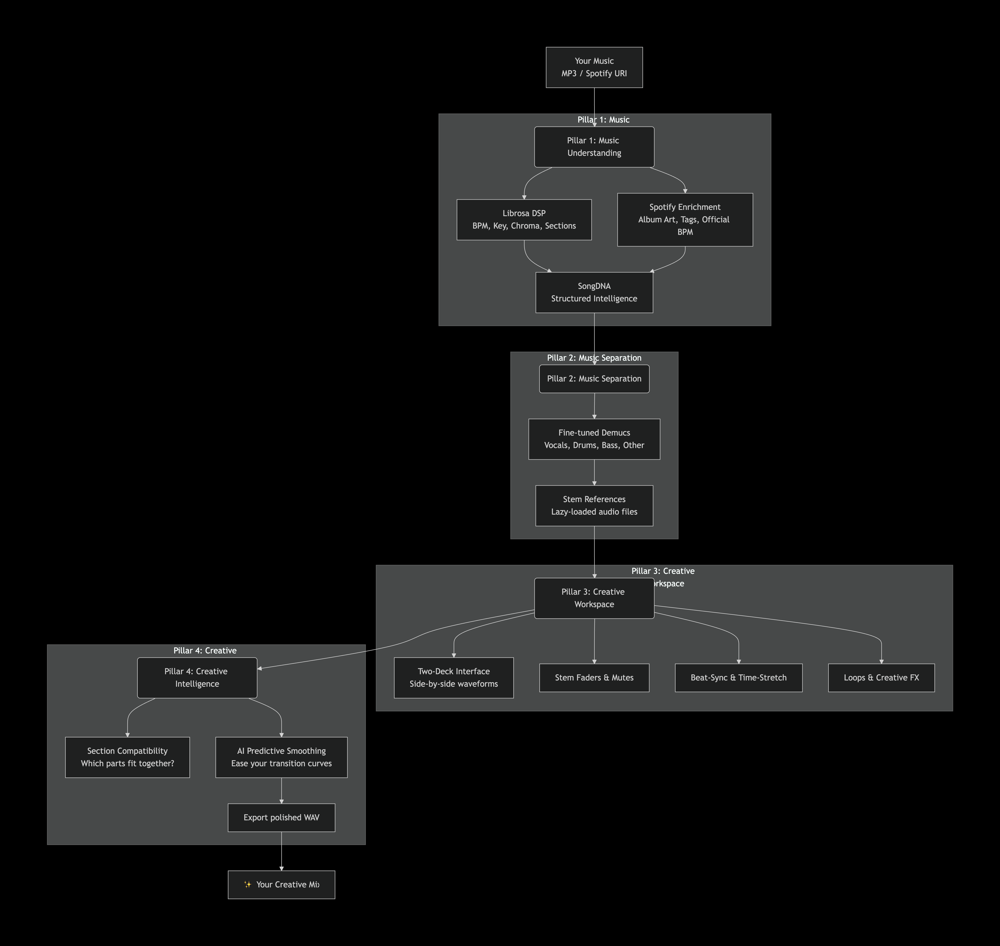
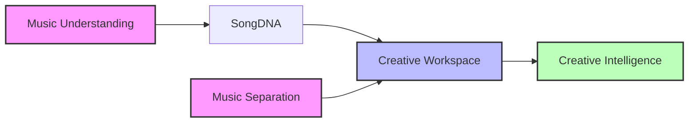
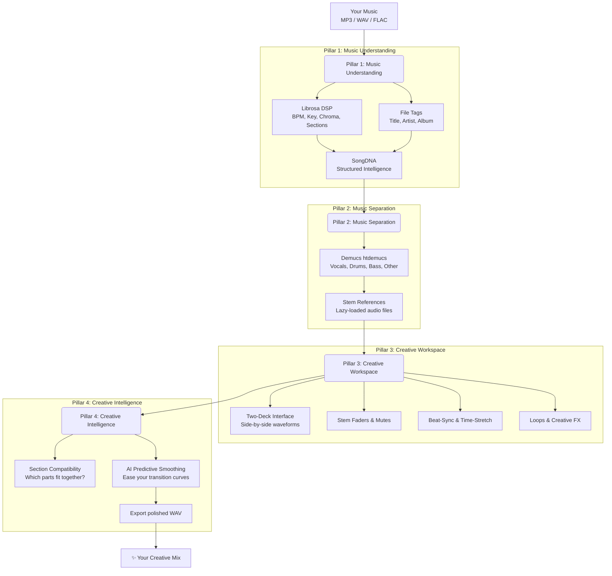

# EchoInsight

**X-ray vision for music. A creative workspace for the curious conductor.**



EchoInsight is an AI-powered desktop platform that lets you see inside a song, separate its layers, and creatively mix two tracks side-by-side. It bridges the gap between raw audio analysis and hands-on musical experimentation.

Built on four robust pillars:



---

## The Journey: Hear → See → Understand → Experiment → Create



---

## The Four Pillars in Detail

| Pillar | What it does | Why it matters | Status |
| :--- | :--- | :--- | :--- |
| **1. Music Understanding** | Extracts tempo, beats, key, timbre and structural segments using **Librosa**. Reads title/artist/album from the file's own tags. | Turns a raw audio file into a structured, explainable **SongDNA**—the engine that powers everything else. | ✅ Implemented, with heuristics and limits listed below |
| **2. Music Separation** | Isolates Vocals, Drums, Bass, and Other using **Demucs** (`htdemucs`); a custom checkpoint can be loaded. No fine-tuned model is in the repo or verified yet. | Gives you the building blocks for creative mixing. You don't just hear the song—you see its ingredients. | 🔬 Separator code exists; the workspace uses pre-separated stems |
| **3. Creative Workspace** | A local two-deck prototype: waveforms, segment timeline, 4-stem volume/mute/solo. Planned: beat-synced playback, loops, effects. | This is the "choir instructor" experience. You conduct the arrangement visually and audibly. | 🚧 Prototype (no beat-sync, loops or effects yet) |
| **4. Creative Intelligence** | Suggests compatible sections between songs (BPM, Key, Chroma, Energy). Offers AI-assisted transition smoothing based on your fader moves. | Takes the guesswork out of mixing. The AI assists without taking over—you remain in control. | 📝 Conceptual Design (Algorithm definition) |

---

## Architecture at a Glance

EchoInsight follows a **strict four-tier layered architecture** to keep concerns separate and maintainable:

```text
┌─────────────────────────────────────────────────┐
│  APPLICATION LAYER  (src.app/)                  │
│  Creative Workspace UI, CLI entry points        │
├─────────────────────────────────────────────────┤
│  INFRASTRUCTURE LAYER  (src.analysis/)          │
│  DSP extraction, separation, comparison         │
├─────────────────────────────────────────────────┤
│  CONFIGURATION LAYER  (src.config/)             │
│  Immutable defaults + user preferences          │
├─────────────────────────────────────────────────┤
│  DOMAIN LAYER  (src.core/)                      │
│  SongDNA — pure, immutable data types           │
└─────────────────────────────────────────────────┘
```

**Golden rule:** Dependencies always point **downward**. The domain knows nothing about audio files, Spotify, or GUIs—it only knows music data.

---

## Getting Started

### Requirements

- Python 3.13+
- Recommended: macOS (M1/M2/M3) or Linux. Windows support is experimental.

### Installation

```bash
git clone https://github.com/kaustubh-commits/ECHOINSIGHT.git
cd EchoInsight
python -m venv venv
source venv/bin/activate  # or `venv\Scripts\activate` on Windows
pip install -r requirements.txt
```

### Launch the Workspace (desktop app)

```bash
python run_workspace.py
```

Load an audio file or a saved package `.json` into Deck A or B. Stems are used only if a pre-separated set exists next to the audio file or in `data/demo_stems/<name>/`.

### Extract SongDNA from an Audio File (command line)

```bash
python main.py path/to/your/song.mp3
```

### Run Tests

```bash
pip install -r requirements-dev.txt
python -m pytest tests/ -v
```

---

## Current State and Known Limitations

What the app shows today, and how far to trust it.

**Measured (deterministic DSP, librosa at 22,050 Hz)**
- Tempo and beat times (`librosa.beat.beat_track`). If no beats are found, the tempo is stored as a 120 BPM **fallback**, flagged `tempo_is_fallback`, and the UI shows "(fallback, not detected)".
- Key, by Krumhansl–Schmuckler correlation of the mean chroma: an estimate for the whole mix (and per segment), not a guaranteed key. It has not been tested on vocal-only stems or non-Western tonal systems.
- RMS, spectral and MFCC statistics per song and per segment.

**Heuristic (simple measures, not validated)**
- Structural segments: boundaries from MFCC novelty and clustering. This is **not section recognition**: every segment is labelled `UNKNOWN`, and the UI shows neutral names (S1, S2, …).
- The comparison bar shows raw differences: tempo difference, keys with Camelot distance (0 = same key or relative major/minor), and a normalised RMS difference. None of these is a match or compatibility score.

**Assumed (not detected)**
- Bars and downbeats: every 4th detected beat is assumed to be a downbeat (4/4). Nothing detects downbeats or other metres. The data records this (`Timeline.downbeats_assumed`), and the timeline says so.

**Not available**
- Tempo confidence: none is computed, so it is stored as unknown (`None`).
- Track metadata comes only from the audio file's own tags; missing fields show as unknown. No Spotify or other catalogue lookup is implemented. A future provider can plug into `CatalogueProvider`, but since late 2024 Spotify's audio-features/audio-analysis endpoints are restricted, so it would supply only basic catalogue data.

**Workspace limitations**
- Playback uses 5 independent Qt media players per deck (1 master + 4 stems) with nothing keeping them in sync, so stems can drift.
- No live stem separation in the UI. It plays pre-separated stems only; `EchoSeparator` exists but needs PyTorch and Demucs installed and is not wired to a button.
- Analysis runs on the UI thread, so the window freezes while a track is analysed.
- No beat-sync, time-stretch, loops, crossfader, effects or recording yet.

---

## Documentation

- [Architecture Guide](docs/ARCHITECTURE.md) — Detailed layer rules and responsibilities.
- [Architecture Decision Records](docs/adr/) — Committed decisions (immutability, aggregate roots, validation).
- [Vision & Design Decisions](docs/VISION.md) — Product philosophy, candidate technologies, and open questions.

---

## Roadmap (Pillar-Aligned)

| Pillar | Milestone | Deliverable | Status |
| :--- | :--- | :--- | :--- |
| **Understanding** | v0.1 – v0.2 | SongDNA domain, librosa extraction, file-tag metadata. | ✅ Core done (no downbeat detection or section labels yet) |
| **Separation** | v0.3.5 | Baseline `htdemucs` SDR evaluation (E003); fine-tuning with loss curves and SDR comparison. | 🔬 Baseline recorded; fine-tuning not yet verified |
| **Workspace** | v0.3 – v0.4 | Side-by-side UI, stem loading, beat-sync playback, loops, and effects. | 🚧 Prototype: UI and pre-separated stems work |
| **Intelligence** | v0.5 – v0.6 | Section compatibility, AI predictive smoothing, WAV export. | 📝 Planning |

---

## License

MIT License. See [LICENSE](LICENSE) for details.